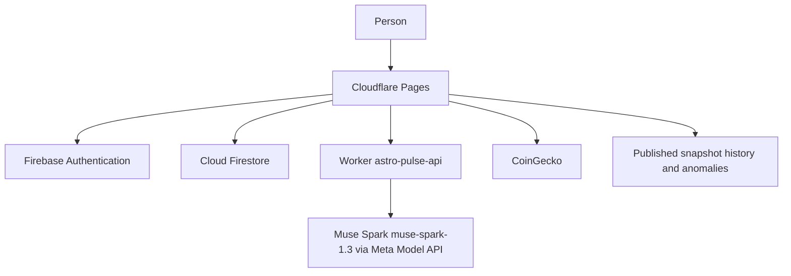

# Pulse

Pulse is a public site for learning how markets feel, without being told what to buy. You ask about a coin, a stock, or a comparison. The reply explains the mood, the case for and against, and what people watch, in plain language. It does not give buy, sell, or hold instructions.

The live site is [https://pulse.lungilemooketsi.engineer](https://pulse.lungilemooketsi.engineer).

The chat is at `/app`. The landing page at `/` shows example replies, not live ones. Signed-in pages also include a Simulation Lab (`/lab`) and an Anomaly Library (`/anomalies`). The method is public at `/model-card`.

## Meta Global AI Developer Hackathon

Pulse is being submitted to the [Meta Global AI Developer Hackathon](https://cerebralvalley.ai/e/meta-ai-developer-hackathon) (Cerebral Valley, 26 October to 4 November 2026).

The model it actually calls is **Muse Spark** (`muse-spark-1.3`) through the [Meta Model API](https://dev.meta.ai/docs) (`https://api.meta.ai/v1/chat/completions`). The chat Worker uses that model for every reply. The data pipeline uses the same API to draft labels, label stock news, and write anomaly categories. Muse Wonder, Muse Image, and SAM 3.1 are not used.

The closer theme is **Build for Your World**. Pulse is for someone learning markets who should not be handed a trade: in South Africa, personal advice on crypto assets needs an FSCA licence under the FAIS Act. The product takes a problem the author knows (scattered headlines, posts, and prices, and the temptation to treat them as a signal) and uses Muse Spark to explain the mood, both sides, and what to watch, so the reader spends less time assembling that picture. It is not a **Push the Frontier** project: it does not add a new machine capability in software research, robotics, manufacturing, energy, or materials.

On the published criteria, Pulse is a working product rather than a demo. The site is live. Cloudflare Pages serves the app, the `astro-pulse-api` Worker checks a Firebase ID token, rate-limits callers, and streams Muse Spark, and Firestore rules limit each person to their own chat history. The event asks for an open-source GitHub repository.

## Past award

An earlier note in this repository says the project won the Build on Base hackathon. That claim is kept as a past award. A primary page listing that event's tracks and this project was not found, so no track is assigned here.

## What you can do

- Ask a question and get a streamed Markdown reply. The prompt in `src/lib/prompt.ts` refuses trading signals, price targets, and predictions. In South Africa, personal advice on crypto assets needs an FSCA licence under the FAIS Act.
- See a recent price chart when a message names a coin. Coin prices come from CoinGecko in the browser. Stock and ETF lines in the Lab come from the published daily history, not from a key in the frontend.
- Read a 24-hour mood for assets that have enough on-topic posts. The snapshot is built by `pipeline/` and shipped with the site. The chat model is given that snapshot as text. It does not score posts itself.
- Replay a made-up portfolio through real daily prices, and browse unusual market episodes since 2015. Both read generated files described in `pipeline/README.md`.

The model card records a comparison from the train run of 4 November 2026. This README does not add scores of its own.
## Architecture



Cloudflare Pages serves the Vite app. Google and email/password sign-in use Firebase Authentication. Chat history is stored at `users/{uid}/conversations/{id}/messages` and loaded when a session starts.

`src/lib/chat.ts` posts the Firebase ID token to `POST {VITE_API_URL}/chat`. The Worker checks that token against Google's public keys (`aud` and `iss` must match `FIREBASE_PROJECT_ID`), rate-limits each user and each IP, and calls Muse Spark (`muse-spark-1.3`). The browser only receives `choices[0].delta.content` lines, then `data: [DONE]`. Reasoning text is dropped in the Worker.

The sentiment pipeline is separate Python. It collects posts and headlines, calls the same Muse Spark model for labels, and writes the snapshot the site displays. Details are in `pipeline/README.md`.

## Security

- `MODEL_API_KEY` is a Worker secret. It is not in the frontend, `.env.example`, or this repository.
- `.env.example` lists only public `VITE_FIREBASE_*` and `VITE_API_URL` names, with empty values. Copy it to `.env` locally and do not commit `.env`.
- Firestore rules allow each signed-in user to read and write only `users/{their uid}/**`.
- The Worker allowlists browser origins, caps how many messages a request can carry and how large each one can be, and limits requests per user and per IP. Those limits are approximate and counted per Cloudflare location.
- The system prompt forbids personal financial advice. `scripts/advice-test.ts` asks the live model a fixed set of advice-seeking questions when the prompt changes.

## Project structure

| Path | What it is |
| --- | --- |
| `src/pages` | Landing, chat, lab, anomaly library, model card |
| `src/components` | Chat, charts, mood, auth gate, shared page chrome |
| `src/lib` | Firebase, chat client, prompt, prices, history, datasets |
| `worker` | `astro-pulse-api`: auth, limits, and the model stream |
| `pipeline` | Collectors, labels, training, history, and anomaly detection |
| `scripts` | Advice check and local checks for the lab and the library |
| `docs/deploy.md` | How to create Firebase, the Worker, and Pages |
| `firestore.rules` | Per-user Firestore access |

## How to run

Requirements: Node.js 22. Live replies also need the Firebase project and the Worker in [docs/deploy.md](docs/deploy.md).

```sh
cp .env.example .env
npm install
npm run dev
```

Fill the empty values in `.env`. The dev server listens on [http://localhost:8080](http://localhost:8080). Without them, the signed-in pages say Firebase is not configured.

`npm run build` writes `dist/`. `npm run lint` runs ESLint. `npm run typecheck` checks the frontend. Worker tests are `npm test --prefix worker`.

## How to deploy

Pages deploys from `main` after the project exists. The Worker and the Firestore rules are deployed by hand. The exact commands, the live origins, and the Firebase project id `astro-pulse-chat` are in [docs/deploy.md](docs/deploy.md).
